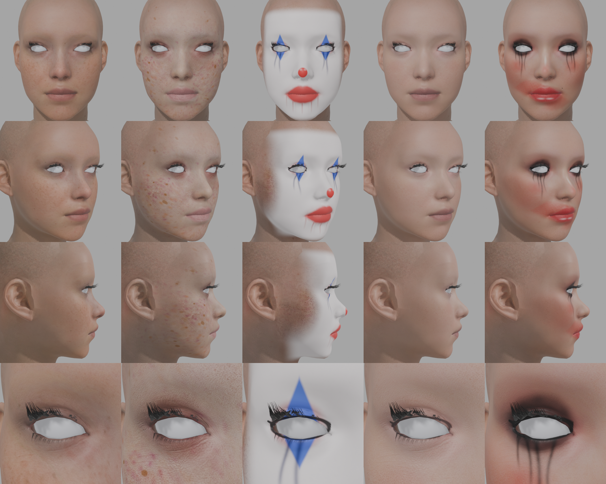
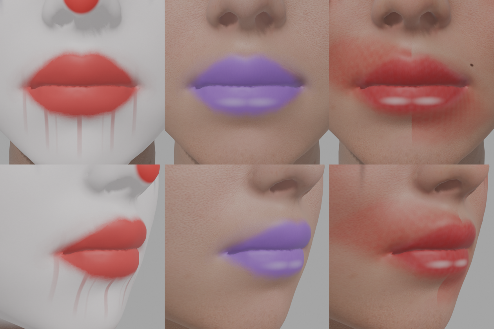
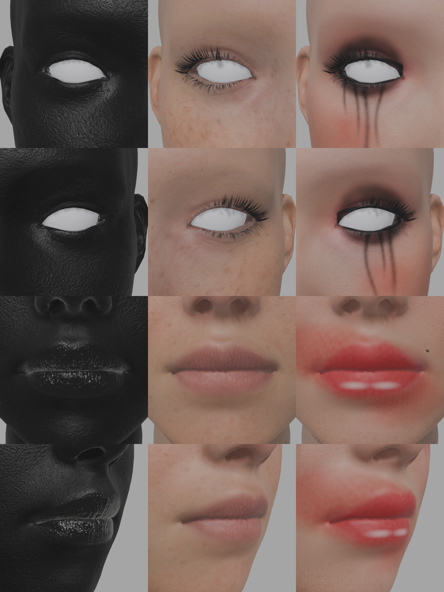
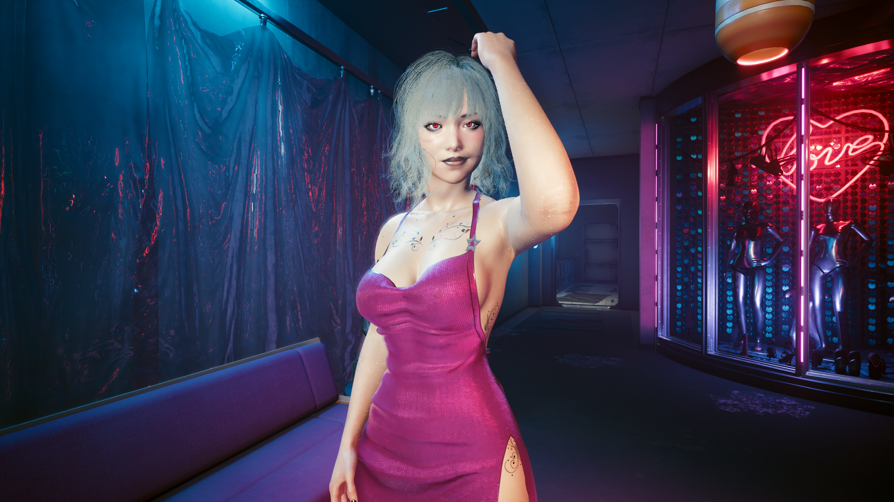
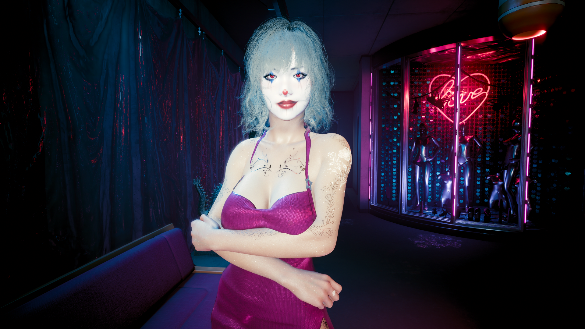
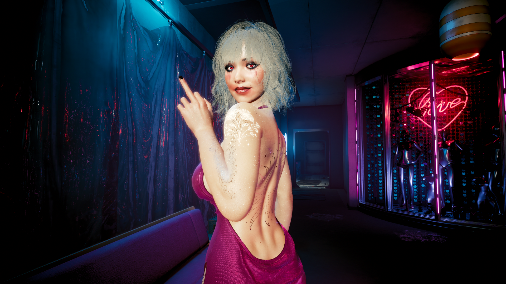

# Selentia

A custom female V head for Cyberpunk 2077 (Inspired looks from Evelyn from Baldur's Gate 3).

## Table of Contents

- [Makeup per skin tone](#makeup-per-skin-tone)
- [In-Game Gallery](#in-game-gallery)
- [Requirements](#requirements)
- [Installation](#installation)
- [Works with](#works-with)
- [Credits](#credits)

## Makeup per skin tone

Each of the five skin tones has its own look, built on VTK's skin:

| Skin tone | Look |
|---|---|
| 1 | Clean, no makeup |
| 2 | Light: soft mauve lids, thin brown liner, light blush, rosy lips |
| 3 | Clown: white face, blue diamond eyes with tear streaks, black liner, red nose, red lips with drips |
| 4 | Dark liner with a small wing, light blush |
| 5 | Ruined: black smudged eyes with running mascara, smeared red lipstick, heavy flush, wet shine |

<table>
  <tr>
    <td width="50%">
      
    </td>
    <td width="50%">
      <strong>Face makeup comparison</strong> 
      The sheet compares all five looks from the front and in profile. The options progress from clean skin and light freckles to clown-inspired face paint, dark liner, and ruined mascara and lipstick.
    </td>
  </tr>
</table>

<table>
  <tr>
    <td width="50%">
      
    </td>
    <td width="50%">
      <strong>Lip and expression variants</strong> 
      These variants show red and mauve lips, side-profile shape, gloss, and lip streaks. The custom lips provide a base for the lipstick options that can still be selected in-game.
    </td>
  </tr>
</table>

<table>
  <tr>
    <td width="50%">
      
    </td>
    <td width="50%">
      The final model combines the inspired sculpted face, VTK skin, five custom in-game makeup variants, custom eyelashes, and custom lips. 
    </td>
  </tr>
</table>

In-game lipstick, makeup, tattoos, scars, piercings and brow styles still layer on top of all of them.

## In-Game Gallery

### Simple Look

<table>
  <tr>
    <td width="50%">
      
    </td>
  </tr>
</table>

### Clown Makeup

<table>
  <tr>
    <td width="50%">
      
    </td>
  </tr>
</table>

### Ruined Makeup

<table>
  <tr>
    <td width="50%">
      
    </td>
  </tr>
</table>

## Requirements

- Cyberpunk 2077, patch 2.5 or later
- [**VTK** (Vanilla HD Head + Head Textures).](https://www.nexusmods.com/cyberpunk2077/mods/7054?tab=files)

## Installation

1. Remove any older version of this head from `Cyberpunk 2077\archive\pc\mod`.
2. Copy `#selentia-vtk.archive` into `Cyberpunk 2077\archive\pc\mod`.
   The `#` makes it load before VTK. With a mod manager, put it **above** VTK.
3. Start a **new character** and pick the female body OR Load in with your existing character.

## Works with

- Every hairstyle, hat and hood
- Brow styles, eye colours, lipstick and makeup options, tattoos, scars, piercings, cyberware
- Facial expressions and photo mode
- All five skin tones

## Credits

- **Evelynn** head preset ("xx Head HEL") for Baldur's Gate 3: face shape and lip shape inspiration.
- **VTK** by **xBaebsae**: skin textures underneath the makeup
- **Eve** (Stellar Blade): lash strands
- **WolvenKit** and the **WolvenKit Blender IO Suite**: import and export tools
